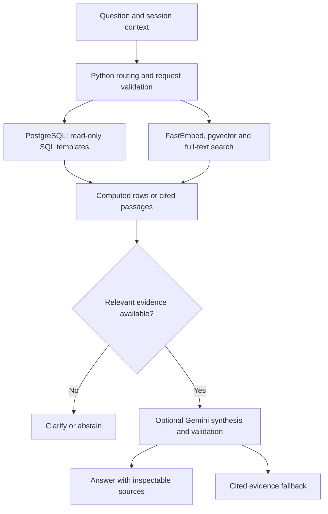

# Enterprise Internal Assistant

Finding an answer inside a company often means switching between policy documents, campaign briefs and database reports. I built this assistant to bring those sources into one conversation: ask a question, inspect the evidence, and see where the answer came from.

**Python · PostgreSQL · pgvector · Gemini · FastEmbed · Streamlit · Docker**

<p align="center">
  <a href="https://huggingface.co/spaces/gustavoscience/crestline-internal-assistant">
    
  </a>
</p>
<p align="center">Ask a question. Inspect the answer. Explore its sources.</p>

The interactive demo uses **Crestline**, a fictional company with versioned business records and documents. The interface displays the response mode: Gemini with sources when configured and available, or concise verified data and source selections otherwise.

## What the assistant delivers

- **Business answers backed by SQL:** sales totals, monthly and quarterly filters, and department aggregates from parameterized, read-only templates.
- **Document search with citations:** hybrid semantic and keyword retrieval across HR, marketing and product documents.
- **Inspectable results:** expandable sources, query details, a sales chart, quick questions and session-local conversation history.
- **Explicit boundaries:** missing data and unsupported requests produce clarification or an out-of-scope response.

| Example question | Expected evidence-backed result |
|---|---|
| How many Crestline X phones were sold in total? | **112,182 units** in the 2024 fixture, with the supporting aggregate. |
| Which month had the highest Crestline X sales in 2024? | **November: 12,974 units**, from recorded sales. |
| What is the maximum PTO carryover? | **10 days**, with a policy citation. |
| Crestline X sales in 2026 | Clarification that the requested records are unavailable. |

These examples are fixture facts, not company performance improvements. An explicit follow-up such as “And Q2?” retains the product and changes the requested quarter.

## Verified evaluation

**14 of 14 fixed regression checks passed** in the [recorded CI evaluation](https://github.com/gusbakers/enterprise-internal-assistant/actions/runs/38577663490), which also passed PostgreSQL integration tests and the Docker startup check.

| Evaluation area | Cases | What is checked |
|---|---:|---|
| Structured analytics | 5 | Exact SQL results for totals, counts, a peak month and a monthly filter |
| Document retrieval | 5 | Expected source retrieval, selected facts and a Spanish-language question |
| Request boundaries | 4 | Missing periods, unsupported breakdowns, unrelated questions and a secret-request prompt |

The [evaluation script](scripts/evaluate.py) writes per-case evidence and results to `results/evaluation.json`, uploaded by CI. **This is a fixed regression benchmark, not a general accuracy score.** Gemini is disabled for that evaluation; live generation quality and response latency require separate measurement. [Current checks](https://github.com/gusbakers/enterprise-internal-assistant/actions).

## How it works



SQL templates use bound parameters and a five-second statement timeout. Document retrieval combines **384-dimensional multilingual embeddings**, exact cosine search and PostgreSQL full-text ranking. Gemini output is checked for valid source IDs and supported numeric values; invalid or unavailable generation falls back to concise evidence.

The corpus contains **nine source documents**, 60 sales records, six department aggregates representing 100 employees, 20 campaign records and 12 monthly metric records. Dataset fingerprints prevent silent replacement of changed fixtures. The small corpus uses exact vector search; the [architecture guide](docs/ARCHITECTURE.md) explains indexing, ranking and the complete request flow.

## Run the application

Docker starts the application and PostgreSQL/pgvector together; no external database account is required.

```bash
git clone https://github.com/gusbakers/enterprise-internal-assistant.git
cd enterprise-internal-assistant
docker build -t crestline .
docker run --rm --name crestline -p 7860:7860 crestline
```

Open `http://localhost:7860`. Stop the container with `docker stop crestline`. The demo database is ephemeral and rebuilt from versioned fixtures in a new container.

For Gemini synthesis, copy `.env.example` to `.env`, set `GEMINI_API_KEY`, select an available model with `GEMINI_MODEL`, and run:

```bash
docker run --rm --name crestline -p 7860:7860 --env-file .env crestline
```

On Hugging Face, configure the key as a Space secret. Provider errors remain visible through the response mode. An external database can be configured with `DATABASE_URL`; use a dedicated database with permission to create the `vector` extension and `crestline` schema.

## Tests and operating scope

```bash
pip install -r requirements-dev.txt
python -m pytest -q

# Set DATABASE_URL to a dedicated PostgreSQL + pgvector test database first.
python -m crestline.database
python -m pytest -q
python -m scripts.evaluate
```

Without PostgreSQL, unit tests use a fixture adapter and integration tests are skipped. CI runs against PostgreSQL and verifies the actual container before deployment.

The demo exposes aggregate business data and versioned documents. Production deployment would require authentication, role-based access, a least-privilege database account, durable storage, rate limits and operational monitoring. Citation and numeric checks reduce specific failure modes but do not prove that every generated claim is supported. English and Spanish questions are supported; evidence-only excerpts retain their source language.

## Repository guide

| Path | Purpose |
|---|---|
| `app.py` | Conversation interface and evidence viewer |
| `crestline/` | Routing, SQL, retrieval, database and Gemini integration |
| `docs/`, `data/business.json` | Versioned company documents and business fixture |
| `tests/`, `scripts/evaluate.py` | Unit, integration and regression evaluation |
| `Dockerfile`, `scripts/start.sh` | Database and application lifecycle |
| `.github/workflows/` | Validation and Space deployment |

**Gustavo** · Master's in Data Science · [GitHub](https://github.com/gusbakers) · [LinkedIn](https://www.linkedin.com/in/gustavo-f-a27066145)

[MIT license](LICENSE).
