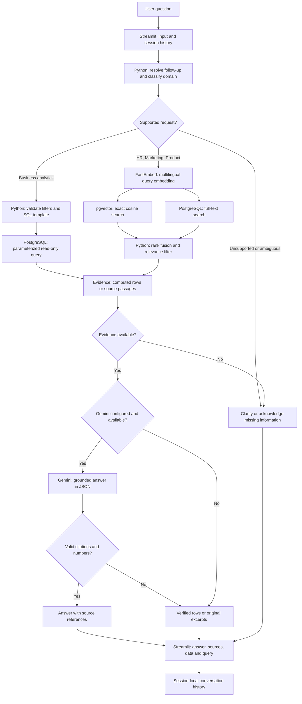
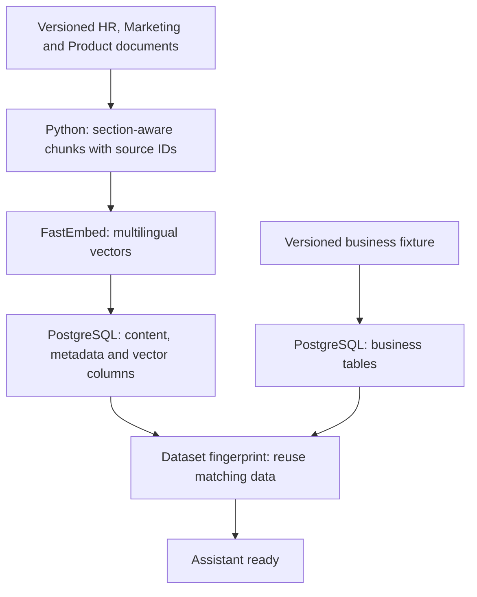

# Crestline Internal Assistant

Finding an answer inside a company often means switching between policy documents, campaign briefs and database reports. I built Crestline to bring those sources into one conversation: ask a question, inspect the evidence, and see where the answer came from.

**Python · PostgreSQL · pgvector · Gemini · FastEmbed · Streamlit · Docker**

[Open the assistant](https://huggingface.co/spaces/gustavoscience/crestline-internal-assistant) · [Tests and deployment](https://github.com/gusbakers/enterprise-internal-assistant/actions)

Crestline is a fictional company with a reproducible dataset. The app always identifies its response mode: **Gemini with sources** when the API is configured and succeeds, or **verified data / source excerpts** otherwise. A working evidence-mode demo is not presented as a successful Gemini call.

## From question to answer



| Stack | What happens |
|---|---|
| **Streamlit** | Collects the question, keeps the last turns in that browser session, displays evidence and optional SQL details. Shared resources are cached; conversation state is not shared between users. |
| **Python** | Resolves explicit follow-ups such as “And Q2?”, routes to one domain, validates supported filters and handles unsupported requests. Routing is deterministic, not an autonomous multi-agent system. |
| **PostgreSQL** | Stores sales, employee aggregates, campaign metrics and company metrics. SQL templates use bound parameters and read-only transactions with a five-second statement timeout. |
| **FastEmbed / ONNX** | Encodes document passages and questions using `paraphrase-multilingual-MiniLM-L12-v2` (384 dimensions), without PyTorch or a paid embedding API. |
| **pgvector + full-text search** | Combines exact cosine search and lexical ranking using reciprocal rank fusion. Source restrictions and a similarity gate remove some irrelevant results. Thresholds remain an evaluation choice, not a correctness guarantee. |
| **Gemini** | Optionally rewrites the retrieved evidence into a concise answer. JSON output includes source IDs; invalid references or unsupported numeric values fall back to original evidence. No LLM-generated SQL is executed. |
| **Docker / Hugging Face** | Starts PostgreSQL on a private Unix socket, loads the reproducible dataset, then starts Streamlit on port 7860. An external PostgreSQL connection can be supplied instead. |
| **GitHub Actions / pytest** | Checks SQL ground truth, routing, unsupported questions, retrieval against actual pgvector and container startup before syncing the Space. |

## How documents become searchable



The loader preserves short sections, attaches document headings, and checks a dataset fingerprint. Matching data is reused on restart; a changed dataset requires a fresh demo database instead of silently overwriting an existing one. This small corpus uses exact vector search; an HNSW index is not necessary at this size.

## Try these questions

| Question | What to inspect |
|---|---|
| How many Crestline X phones were sold in total? | 112,182 units across the 2024 fixture; inspect the sum and source rows. |
| Which month had the highest Crestline X sales in 2024? | November, 12,974 units. |
| How many employees work in Engineering? | 30 employees. |
| What is the maximum PTO carryover? | Policy evidence describing 10 days. |
| Who is the target audience for the Crestline Watch campaign? | The campaign brief and audience section. |
| What are the Cloud API rate limits? | Product documentation, with the relevant plan tier. |
| Crestline X sales in Q1 2024 → And Q2? | An explicit follow-up retains the product and changes the quarter. |
| Crestline X sales in 2026 | Acknowledges that those records are unavailable. |

These are dataset facts and regression expectations, not measured real-company outcomes.

## Run locally

Docker provides the application **and** PostgreSQL/pgvector; no external database account is required.

```bash
git clone https://github.com/gusbakers/enterprise-internal-assistant.git
cd enterprise-internal-assistant
docker build -t crestline .
docker run --rm --name crestline -p 7860:7860 crestline
```

Open `http://localhost:7860`. To stop it, use `docker stop crestline`. The demo database is ephemeral and rebuilt from checked-in fixtures on a new container. It is not a persistent production database.

To enable Gemini, copy `.env.example` to `.env`, set `GEMINI_API_KEY` locally, and run:

```bash
docker run --rm --name crestline -p 7860:7860 --env-file .env crestline
```

On Hugging Face, set `GEMINI_API_KEY` under **Settings → Variables and secrets → New secret**. `GEMINI_MODEL` selects the model; the default is `gemini-3.8-flash`. Model availability and API quotas depend on the provider account. An API error is visible as evidence mode, not silently described as successful synthesis.

For an external PostgreSQL instance, set `DATABASE_URL` to a dedicated empty demo database with permission to create the `vector` extension and `crestline` schema. The image uses PostgreSQL 17; the `pgvector/pgvector:pg17` base follows that upstream tag.

## Tests and evaluation

```bash
pip install -r requirements-dev.txt
python -m pytest -q

# With DATABASE_URL pointing to a dedicated PostgreSQL + pgvector test database:
python -m crestline.database
python -m pytest -q
python -m scripts.evaluate
```

Without PostgreSQL, unit tests use an in-memory fixture adapter and the integration tests are explicitly skipped. CI runs the integration tests on PostgreSQL, builds the actual Docker image and checks the running container.

`results/evaluation.json` records each question, expected check, actual response, sources, timings and pass/fail. The CI run uploads it as an artifact. The checks measure fixed SQL values, retrieval evidence and abstention. **They do not measure general answer accuracy or Gemini answer quality.** There are no random RAGAS scores and no unverified “100% accuracy” claims. Gemini contract tests mock the API; an authenticated live evaluation is a separate step.

## Design choices and scope

- **PostgreSQL + pgvector** replaces SQLite plus local Qdrant, keeping relational records and vector content in one database. Qdrant remains a valid alternative; the migration is about this project's data model, not claiming one engine is universally better.
- **SQL templates** deliberately cover a bounded analytics scope. Unsupported periods, customer-level purchases, sales-channel breakdowns and comparisons request clarification instead of inventing an answer.
- **Evidence first:** citations, source text and computed rows stay inspectable. Citation and number checks reduce some failure modes but do not prove every generated claim is entailed by its source.
- **Public demo, not production HR:** no real personal records, no uploads, no arbitrary queries. Employee outputs are aggregate counts or salaries. Production use would need authentication, role-based access, a least-privilege database account, durable storage, global rate limits and monitoring.
- **Multilingual retrieval** supports English and Spanish queries. In evidence mode, document excerpts retain their original English; Gemini can synthesize a Spanish answer when available.
- **Dataset scope:** nine source documents; 60 sales rows, six department aggregates representing 100 employees, 20 campaign rows and 12 monthly metrics rows. Business facts cover 2024. Briefs describe plans; database rows describe demo recorded metrics. They are not interchangeable.

## Project layout

```text
app.py                 Streamlit conversation and evidence viewer
crestline/             Routing, SQL, retrieval, Gemini, database and source models
docs/                  Versioned company documents
data/business.json     Reproducible business fixture
tests/                 Unit and PostgreSQL integration tests
scripts/evaluate.py    Ground-truth regression evaluation
scripts/start.sh       PostgreSQL and Streamlit lifecycle
Dockerfile             Self-contained deployment
.github/workflows/     Validation and Space deployment
```

Built by **Gustavo** · Master's in Data Science · [GitHub](https://github.com/gusbakers) · [LinkedIn](https://www.linkedin.com/in/gustavo-f-a27066145)

MIT — see [LICENSE](LICENSE).
