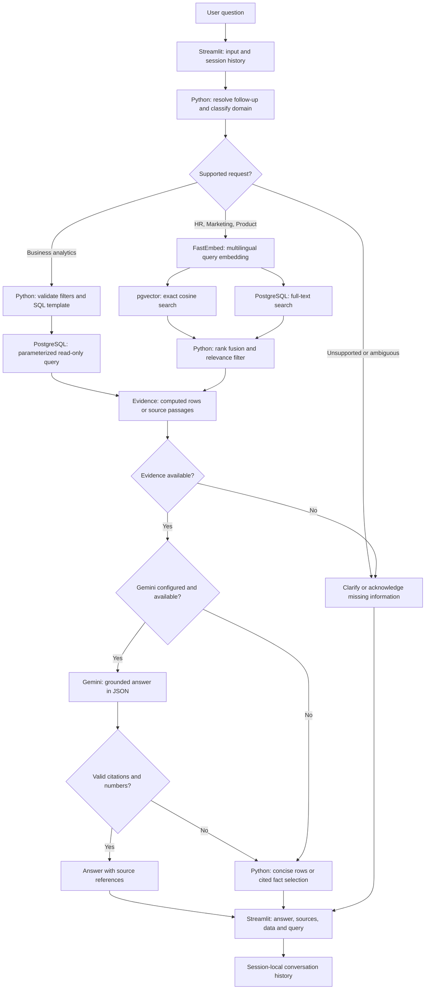
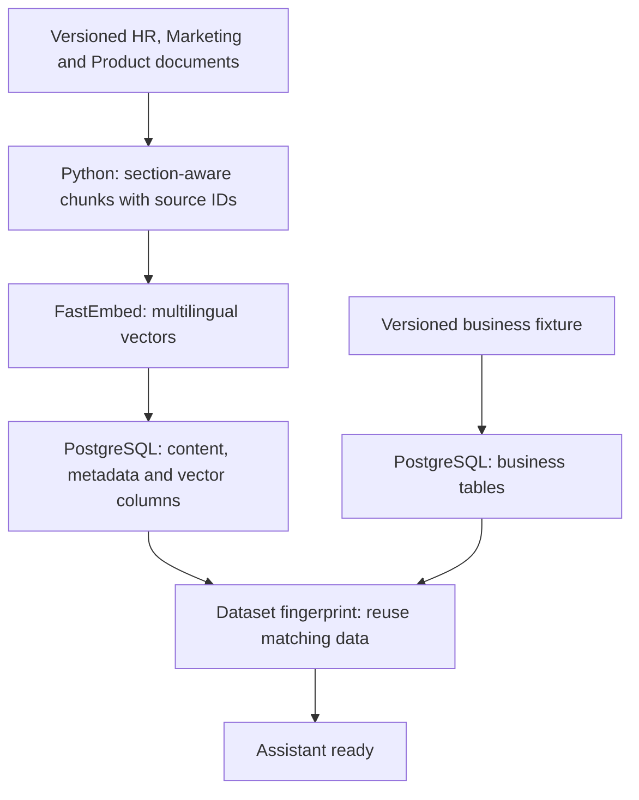

# Assistant architecture

[Project overview](../README.md)

## Request processing

| Stack | What happens |
|---|---|
| **Streamlit** | Collects the question, keeps the last turns in that browser session, displays evidence and optional SQL details. Shared resources are cached; conversation state is not shared between users. |
| **Python** | Resolves explicit follow-ups such as “And Q2?”, routes to one domain, validates supported filters and handles unsupported requests. Routing is deterministic, not an autonomous multi-agent system. |
| **PostgreSQL** | Stores sales, employee aggregates, campaign metrics and company metrics. SQL templates use bound parameters and read-only transactions with a five-second statement timeout. |
| **FastEmbed / ONNX** | Encodes document passages and questions using `paraphrase-multilingual-MiniLM-L12-v2` (384 dimensions), without PyTorch or a paid embedding API. |
| **pgvector + full-text search** | Combines exact cosine search and lexical ranking using reciprocal rank fusion. Source restrictions and a similarity gate remove some irrelevant results. Thresholds remain an evaluation choice, not a correctness guarantee. |
| **Gemini** | Optionally rewrites the retrieved evidence into a concise answer. JSON output includes source IDs; invalid references or unsupported numeric values fall back to concise cited evidence. Answers are instructed to stay within 80 words. No LLM-generated SQL is executed. |
| **Docker / Hugging Face** | Starts PostgreSQL on a private Unix socket, loads the reproducible dataset, then starts Streamlit on port 7860. An external PostgreSQL connection can be supplied instead. |
| **GitHub Actions / pytest** | Checks SQL ground truth, routing, unsupported questions, retrieval against actual pgvector and container startup before syncing the Space. |

## Document indexing

The loader preserves short sections, attaches document headings, and checks a dataset fingerprint. Matching data is reused on restart; a changed dataset requires a fresh demo database instead of silently overwriting an existing one. This small corpus uses exact vector search; an HNSW index is not necessary at this size.
